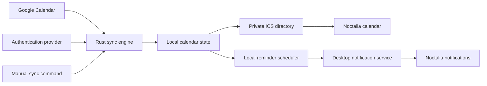

# Calendar daemon — design draft

An independent Rust desktop daemon that owns calendar synchronization and reminders. Noctalia consumes its local calendar export and presents standard desktop notifications. `calendar-daemon` is a provisional project and executable name.

> **Implementation status.** This design is now implemented. See [decisions.md](decisions.md) for the behaviours this document left open and how each was resolved, [install.md](install.md) for setup and rollback, and [validation.md](validation.md) for what has been verified and what still needs a live account. The sections below describe the intended design; where the implementation had to choose, `decisions.md` records the choice.

## Responsibilities



The daemon owns authentication, synchronization, reminder scheduling, deduplication and local export. Noctalia retains calendar navigation, event links and notification presentation. Hyprland supplies the desktop session; calendar logic does not depend on its IPC or configuration format.

## Proposed CLI and configuration

The following commands and TOML are a proposed interface, not runnable instructions:

```text
calendar-daemon run       # foreground process for a user service
calendar-daemon sync      # request a sync now; support one-shot use when stopped
calendar-daemon status    # last success, next sync, next reminder, auth health
calendar-daemon auth      # explicit Google desktop authorization in the browser
```

```toml
[sync]
on_start = true
periodic = true
interval = "6h"
```

Six hours is a suggested starting value, not a user-selected requirement. `periodic = false` allows startup/manual-only synchronization. `on_start = false` independently disables startup synchronization. Invalid intervals fail configuration validation with an actionable error.

Sync frequency and reminder timing are independent. After loading an event whose reminder is due at 08:50, the daemon waits for 08:50 locally even when the next Google sync is hours away. Network requests occur for synchronization and necessary authorization refresh, not for every reminder clock tick. A longer interval increases how long edits or cancellations remain unknown; manual sync provides an immediate update.

The background process owns writes and notification scheduling. A manual command contacts the running process through a private local control channel. Concurrent requests coalesce. If stopped, one-shot sync may update state/export while holding the same exclusive lock, but must not create a second reminder scheduler.

## Authentication

Use a dedicated Google OAuth client registered as Desktop app. The initial setup enables the Calendar API and supplies this client's configuration locally. A developer may create a separate Desktop client in an existing Google Cloud project; a new Cloud project is not intrinsically required. Publishing source code and configuring a publicly distributed OAuth application are separate tasks.

`auth` binds a temporary listener to the numeric loopback address on an available port, generates fresh PKCE S256 and state values, and opens the system browser. Validate state, callback path and the granted scopes before accepting credentials; bound the interaction by a timeout and close the listener afterward. The daemon retains no persistent HTTP listener for authentication. Use Google's offline-access flow, keeping a refresh token in the desktop keyring and short-lived access tokens in memory. The installed application's client configuration is not a security boundary: Google treats distributed native applications as public clients.

Request only `https://www.googleapis.com/auth/calendar.events.readonly` and `https://www.googleapis.com/auth/calendar.calendarlist.readonly`, which cover event reads and calendar discovery/defaults. Do not request Cloud Platform or Gmail access. Tokens previously issued for identity-only sign-in do not authorize Calendar; the daemon requires its own consent and grant. Do not share mutable token storage with another application or use gcloud/Noctalia credentials.

Refresh on demand before a scheduled or manual API synchronization if the access token is absent or near expiry. Sleeping through an access token's expiration is harmless while the refresh grant remains valid; there is no hourly keep-alive job. Retain the stored refresh token when Google's successful response omits a replacement. Persist a replacement safely before depending on it, and serialize refresh operations so concurrent commands do not race. A 401 can trigger one refresh/retry, not an unbounded loop.

Classify failures by status and parsed OAuth code/subtype. Network errors, 429 and server errors use bounded retry/backoff and preserve credentials. A confirmed invalid grant produces an actionable authentication-required state, with sanitized `error_subtype` when present; configuration failures such as invalid_client are a separate state. A locked/unavailable keyring is not a revoked grant. Avoid deleting durable credentials merely because a request failed. Logging may record allowlisted error categories/statuses and timestamps, never token-bearing requests/responses or unfiltered provider error descriptions.

The reviewed remote MCP uses Google identity scopes and issues its own client-facing credentials. It is a conceptual reference for PKCE, offline access, refresh and token-rotation handling, not a runtime dependency or a source of reusable Calendar grants. Its authorization server, public callback, identity allowlist and sealed client-credential protocol do not belong in this local program. No Go code or cryptographic format is copied.

Google can expire or revoke authorization. Identity-only OAuth applications have a documented exception to the usual External/Testing seven-day refresh-token limit; Calendar permissions do not meet that identity-only exception. The MCP's observed session longevity therefore does not establish Calendar token lifetime. The daemon should request explicit reauthorization only when necessary and never repeatedly open a browser in the background.

## Resource model

One Rust process waits for the next local reminder, synchronization deadline or command. A long synchronization interval does not entail repeated network polling or a separate process per reminder. Notification actions run without blocking the scheduler. Reuse the HTTP client during a synchronization cycle and fetch a bounded date range with pagination, requesting only the fields needed for display and reminders.

The first implementation favors complete snapshots of that bounded range at the configured interval. Incremental sync is a later optimization if measurements justify its extra state and recovery paths. In particular, Google's syncToken cannot be combined with a moving timeMin/timeMax window. Do not infer that Rust itself guarantees lower resource use than Go: the proposed savings come from a single local process, bounded state, infrequent requests and deadline-driven waiting. Measure the resulting implementation.

## Calendar and reminder state

Retrieve calendar defaults and event-specific reminder overrides. Preserve explicit disabled reminders; use popup reminders for desktop alerts and leave email delivery to Google. Handle pagination, recurring instances, time zones, declined/cancelled events and multiple reminders. Reminder-only edits must be detected without relying exclusively on an event's `updated` timestamp.

Keep a last successful local snapshot and a delivered-reminder ledger. Failed or incomplete downloads do not erase the previous calendar. Document the age of offline data in status. Persist only the minimum needed event information; do not log event contents or authentication responses. File permissions restrict local state and exports to the user. ICS exports necessarily contain readable event fields for the visual client; they are not encrypted calendar files.

After a restart, restore state and deduplication before scheduling. After resume or wall-clock changes, recompute deadlines and request an update when configured. Catch-up behavior for already elapsed reminders is an open design choice; it must not silently emit an unlimited backlog. Notification action handling must not block later reminders. Meeting links must be valid HTTP(S) URLs opened without shell interpolation.

## Noctalia integration

Configure a Local (vdir) calendar account pointing at the daemon's export directory. Noctalia 5.1.0 already watches these directories and imports changes; the daemon need not edit Noctalia's encrypted cache or call a custom internal API.

Proposed export: one complete `.ics` snapshot per calendar, in a stable collection directory, with optional `displayname` and `color` metadata. Write a temporary file and rename it atomically after successful serialization. Include resolved occurrences with stable identities and a deliberate meeting URL. Validate this concrete-instance representation against Noctalia's parser before treating recurrence support as complete.

Preserve a valid empty VCALENDAR snapshot when a calendar becomes empty. Noctalia's reader treats no discovered collections as a failed refresh and can retain old events; deleting the last `.ics` alone would therefore be incorrect. Create the root directory before adding the local account so Noctalia can watch it.

Migration is a user-session operation: validate the local source, then replace the equivalent Google source in Noctalia to avoid duplicates and its Google authorization dependency. Preserve a rollback path. No live configuration has been changed by this draft.

## Packaging and validation

Build a normal standalone Cargo project with a CLI, library modules for the core rules, a user-service definition, examples, installation/rollback documentation and CI. Keep workstation paths, account identifiers, credentials and runtime calendars outside the repository. Select a license with the owner before publication. No GitHub repository has been created or published.

Prioritize tests for reminder inheritance/disablement, recurrence identity, restart deduplication, rescheduling, empty-calendar exports and provider failures. Separate tests with a local fake provider from a real Google/Noctalia user-session check. Measure idle and synchronization CPU/RSS and request counts on the built daemon; no resource figures are claimed yet.

## Evidence

- [Noctalia local calendars](https://docs.noctalia.dev/noctalia/services/calendar/#local-directory-vdir--vdirsyncer).
- [Noctalia vdir reader, v5.1.0](https://github.com/noctalia-dev/noctalia/blob/v5.1.0/src/calendar/vdir_reader.cpp#L203).
- [Noctalia refresh/error behavior](https://github.com/noctalia-dev/noctalia/blob/v5.1.0/src/calendar/calendar_service.cpp#L189).
- [Noctalia file watcher](https://github.com/noctalia-dev/noctalia/blob/v5.1.0/src/calendar/calendar_service.cpp#L874).
- [Google desktop OAuth](https://developers.google.com/identity/protocols/oauth2/native-app).
- [Google refresh-token lifetime](https://developers.google.com/identity/protocols/oauth2#expiration).
- [Google event listing and supported scopes](https://developers.google.com/workspace/calendar/api/v3/reference/events/list).
- [Google calendar discovery and supported scopes](https://developers.google.com/workspace/calendar/api/v3/reference/calendarList/list).
- [Google reminder fields](https://developers.google.com/workspace/calendar/api/v3/reference/events).
- [Google calendar defaults](https://developers.google.com/workspace/calendar/api/v3/reference/calendarList).
